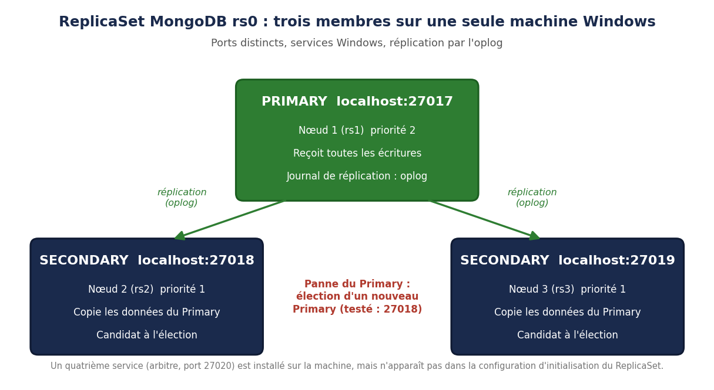

# ReplicaSet MongoDB : haute disponibilité, élection et réintégration d'un nœud

Projet du module **Bases de Données NoSQL** (INGC-INDIA, ESMT Dakar, formateur : M. PREIRA). Il étudie le mécanisme de réplication de MongoDB, puis déploie un **ReplicaSet** de trois membres sur une machine Windows et en teste le comportement : réplication, basculement automatique en cas de panne du Primary, réintégration d'un nœud.

Projet réalisé en équipe de trois : BOUGOUM Cheick, HOUNKANRIN Fahouk, SISSAO Grace.



## Problématique

Une instance MongoDB unique est un point de défaillance : une panne ou une mise à jour ratée rend l'application inaccessible. Comment garantir la **haute disponibilité** et la **continuité de service** tout en gardant des données cohérentes ? Le ReplicaSet répond à cette question en maintenant plusieurs copies des données sur des nœuds distincts.

## Concepts étudiés

| Concept | Rôle |
| --- | --- |
| Primary, Secondary, Arbiter | Le Primary reçoit les écritures, les Secondaries en gardent une copie, l'Arbiter vote sans stocker de données |
| Heartbeats et élection | Les membres s'échangent des battements de cœur ; si le Primary disparaît, une élection à la majorité désigne un nouveau Primary |
| Quorum et split-brain | Il faut la majorité des membres votants pour élire un Primary, ce qui évite deux Primaries simultanés après une partition réseau |
| Oplog | Journal des opérations, rejoué par les Secondaries ; un nœud absent se resynchronise en le lisant |
| Write Concern, Read Concern, Read Preference | Réglages du compromis entre durabilité, cohérence et répartition des lectures |

## Environnement

| Élément | Valeur |
| --- | --- |
| Système | Windows 11, une seule machine |
| MongoDB | Community 8.2.6, `mongosh` 2.8.2 |
| Membres | `localhost:27017` (priorité 2), `localhost:27018` et `localhost:27019` (priorité 1) |
| Nom du ReplicaSet | `rs0` |

## Choix techniques et justifications

**Trois membres votants.** Avec trois membres, la majorité est de deux : le ReplicaSet tolère la perte d'un nœud tout en pouvant élire un Primary. Avec deux membres seulement, la perte d'un nœud bloquerait l'élection.

**Priorité 2 pour le nœud 27017.** Les deux autres ont la priorité 1. Le nœud 27017 est ainsi le Primary préféré en fonctionnement normal, et les deux autres peuvent le remplacer en cas de panne.

**Services Windows plutôt que trois terminaux ouverts.** Chaque nœud est installé comme service (`--install`), ce qui évite de perdre un nœud en fermant une fenêtre par erreur et libère les ressources du poste.

**Fichiers de configuration plutôt que des options en ligne de commande.** Les chemins, ports et le nom du ReplicaSet sont versionnés dans `config/`, ce qui rend le déploiement reproductible.

**Écoute sur `127.0.0.1` uniquement.** Les nœuds ne sont pas exposés sur le réseau : adapté à un test local, à compléter par une authentification pour tout autre usage (voir les limites).

## Déploiement

```powershell
# 1. Créer les dossiers et installer les 4 services (PowerShell administrateur)
.\scripts\01_installation_services.ps1

# 2. Initialiser le ReplicaSet depuis mongosh
mongosh --port 27017 --file scripts/02_initialisation_replicaset.js
```

Les fichiers `config/rs1.cfg`, `rs2.cfg`, `rs3.cfg` et `arbiter.cfg` doivent être copiés dans `C:\mongodbRep\mongodb\config`. Les commandes des tests sont dans `scripts/03_tests.js`.

## Tests réalisés

| Test | Ce qui a été fait | Ce qui est observé |
| --- | --- | --- |
| Réplication | Insertion de trois documents dans `ecole.etudiants` sur le Primary (27017) | Les trois documents sont lisibles sur le Secondary (27018) |
| Failover | Arrêt du Primary avec `db.adminCommand({ shutdown: 1 })` | Le nœud 27018 affiche ensuite l'état `primary` : il a été élu automatiquement |
| Réintégration | Insertion d'un document (Ba Mariama) pendant l'absence du nœud 27017, puis relance de ce nœud | Les quatre documents sont présents après la relance : la resynchronisation par l'oplog fonctionne |

Le délai d'élection suit le paramètre `electionTimeoutMillis`, fixé à 10 000 ms par défaut (valeur visible dans `rs.status()`).

## Rapport

Le rapport complet (étude théorique, déploiement, tests avec captures, limites et conclusion) se trouve dans `docs/Rapport_MongoDB_ReplicaSet_Haute_Disponibilite.pdf`.

## Limites et perspectives

- **Un seul Primary.** Toutes les écritures passent par un seul nœud : ajouter des Secondaries n'améliore pas les performances d'écriture.
- **Pas de partitionnement.** Chaque nœud stocke l'intégralité des données, ce qui devient coûteux pour de grands volumes.
- **Cohérence éventuelle.** Une lecture sur un Secondary peut renvoyer des données légèrement en retard ; `writeConcern: "majority"` et `readConcern` renforcent les garanties.
- **Environnement local.** Les trois membres tournent sur une seule machine, donc une panne de la machine arrête tout : le test valide le mécanisme, pas la résilience matérielle.
- **Pas d'authentification.** La ligne `keyFile` de la configuration est commentée : le contrôle d'accès n'est pas activé.
- **Perspective : le Sharded Cluster.** Il combine plusieurs shards (chacun étant un ReplicaSet), des config servers et des routeurs `mongos` pour répartir données et écritures, au prix d'une complexité d'exploitation nettement plus élevée.

## Contenu du dépôt

```
mongodb-replicaset-haute-disponibilite/
├── README.md
├── config/      rs1.cfg, rs2.cfg, rs3.cfg, arbiter.cfg
├── scripts/     01_installation_services.ps1, 02_initialisation_replicaset.js, 03_tests.js
└── docs/        architecture.png, Rapport_MongoDB_ReplicaSet_Haute_Disponibilite.pdf (rapport complet, 34 pages)
```

## Auteur

**Cheïck Abdoul Aziz BOUGOUM**, élève ingénieur Données et IA, ESMT Dakar
[LinkedIn](https://www.linkedin.com/in/che%C3%AFck-abdoul-aziz-bougoum-7264243aa) · [GitHub](https://github.com/cheickbougoum90-web)
