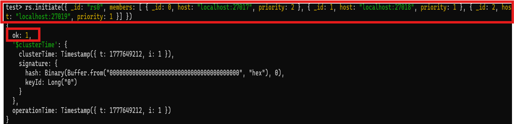
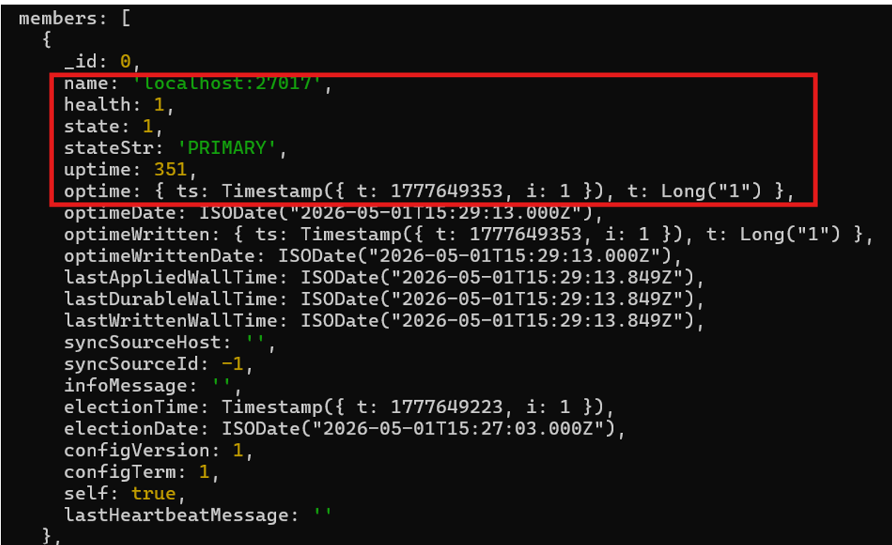
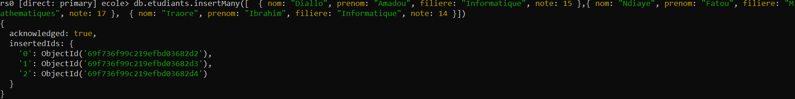
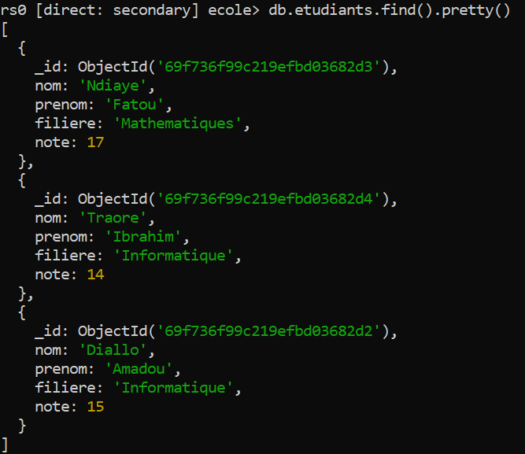
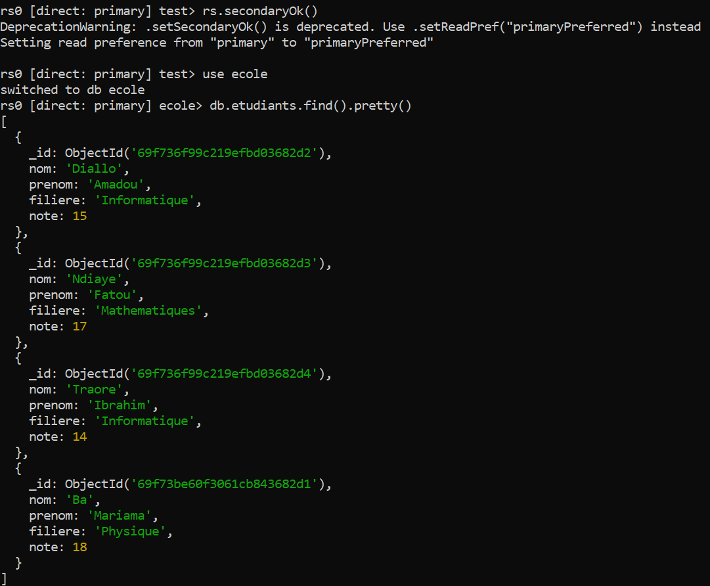
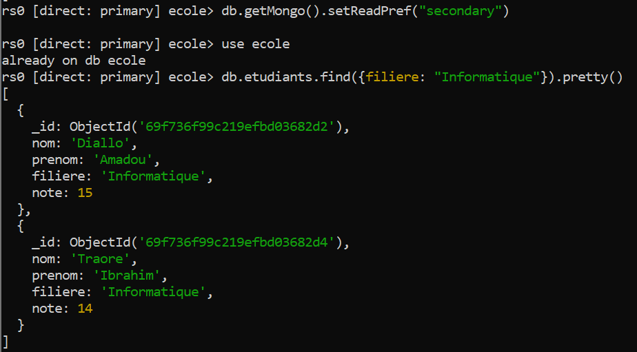

# Haute disponibilité avec un ReplicaSet MongoDB

Étude et mise en œuvre d'un **ReplicaSet MongoDB** sur une seule machine Windows : 3 nœuds de données (+ 1 arbitre optionnel) simulés via des ports distincts, avec tests de réplication, de failover automatique, de réintégration d'un nœud et de lecture sur les Secondaries.

Projet de bases de données NoSQL réalisé à l'**ESMT Dakar** (formateur : M. Preira) par une équipe de 3 étudiants: : BOUGOUM Cheick, HOUNKANRIN Fahouk, SISSAO Grace.
> Le rapport complet (concepts, déploiement, tests, limites) est disponible dans [`docs/Rapport_ReplicaSet_MongoDB.docx`](docs/Rapport_ReplicaSet_MongoDB.pdf).

## Problématique

Comment garantir la haute disponibilité, la tolérance aux pannes et la continuité de service d'une base MongoDB en production, tout en assurant la cohérence et l'intégrité des données ?

## Architecture

| Nœud | Rôle | Port | Priorité | Dossier de données | Service Windows |
|------|------|------|----------|--------------------|-----------------|
| rs1 | Primary (au démarrage) | 27017 | 2 | `C:\mongodbRep\data\rs1` | `MongoDB_RS1` |
| rs2 | Secondary | 27018 | 1 | `C:\mongodbRep\data\rs2` | `MongoDB_RS2` |
| rs3 | Secondary | 27019 | 1 | `C:\mongodbRep\data\rs3` | `MongoDB_RS3` |
| arbiter | Arbiter (optionnel, sans données) | 27020 | n/a | `C:\mongodbRep\data\arb` | `MongoDB_ARBITER` |

Nom du ReplicaSet : `rs0`. Avec 3 membres votants, la majorité est de 2 : le cluster tolère la perte d'un nœud.

## Structure du dépôt

```
mongodb-replicaset/
├── config/                       # Fichiers de configuration mongod (rs1, rs2, rs3, arbiter)
├── scripts/                      # Déploiement et tests (PowerShell + mongosh)
│   ├── 01-setup-directories.ps1  # Arborescence C:\mongodbRep + copie des .cfg
│   ├── 02-start-nodes-manual.ps1 # Démarrage manuel (3 terminaux)
│   ├── 03-install-services.ps1   # Nœuds enregistrés comme services Windows
│   ├── 04-init-replicaset.js     # rs.initiate()
│   ├── 05a / 05b                 # Test 1 : réplication
│   ├── 06-test-failover.ps1      # Test 2 : panne du Primary
│   ├── 07-test-rejoin.ps1        # Test 3 : réintégration d'un nœud
│   ├── 08-test-read-secondary.js # Test 4 : lecture sur Secondary
│   └── 99-cleanup.ps1            # Suppression des services
└── docs/                         # Rapport et captures d'écran
```

## Prérequis

- Windows 11
- MongoDB Community Server (testé avec la **8.2.6**) dont le dossier `bin` est dans le `PATH`
- `mongosh`
- Si l'installateur MongoDB a créé le service par défaut `MongoDB` (port 27017), l'arrêter et le désactiver pour libérer le port.

## Déploiement

### 1. Créer l'arborescence

```powershell
.\scripts\01-setup-directories.ps1
```

### 2. Démarrer les nœuds

**Option A : services Windows (recommandé)**, PowerShell en administrateur :

```powershell
.\scripts\03-install-services.ps1
```

**Option B : terminaux** (3 fenêtres à garder ouvertes) :

```powershell
.\scripts\02-start-nodes-manual.ps1 -Mode config   # ou -Mode cli
```

Équivalent manuel pour un nœud :

```powershell
# En ligne de commande
mongod --replSet rs0 --port 27017 --dbpath C:\mongodbRep\data\rs1 --bind_ip localhost
# Avec un fichier de configuration
mongod --config "C:\mongodbRep\mongodb\config\rs1.cfg"
```

Le paramètre `--replSet rs0` indique à chaque instance qu'elle appartient au ReplicaSet `rs0` : tous les nœuds doivent utiliser le même nom.

### 3. Initialiser le ReplicaSet

```powershell
mongosh --port 27017 --file scripts/04-init-replicaset.js
```

```js
rs.initiate({
  _id: "rs0",
  members: [
    { _id: 0, host: "localhost:27017", priority: 2 },
    { _id: 1, host: "localhost:27018", priority: 1 },
    { _id: 2, host: "localhost:27019", priority: 1 }
  ]
})
```

### 4. Vérifier

```powershell
mongosh --port 27017 --eval "rs.status().members.forEach(m => print(m.name, m.stateStr))"
```

Résultat attendu : `localhost:27017 PRIMARY`, `localhost:27018 SECONDARY`, `localhost:27019 SECONDARY`.

| Champ de `rs.status()` | Signification |
|---|---|
| `name` | adresse `host:port` du nœud |
| `stateStr` | `PRIMARY`, `SECONDARY` ou `ARBITER` |
| `health` | 1 si le nœud est en bonne santé, 0 sinon |
| `optime` | horodatage de la dernière opération répliquée |




## Tests et résultats

### Test 1 : réplication des données

```powershell
mongosh --port 27017 --file scripts/05a-insert-on-primary.js   # insertion sur le Primary
mongosh --port 27018 --file scripts/05b-verify-on-secondary.js # lecture sur un Secondary
```

**Résultat** : les 3 documents insérés sur le Primary apparaissent sur le Secondary quelques millisecondes plus tard. Sans autorisation de lecture, un Secondary répond `not primary and secondaryOk=false` : `rs.secondaryOk()` est déprécié dans mongosh récent, on utilise `db.getMongo().setReadPref("primaryPreferred")`.




### Test 2 : failover (panne du Primary)

```powershell
.\scripts\06-test-failover.ps1
```

Le script arrête le service du nœud 1 puis interroge le nœud 2.

**Résultat** : en 10 à 30 secondes, un Secondary (ici le nœud 27018) est élu Primary et le service est rétabli sans intervention. Pendant l'élection, les écritures sont indisponibles ; le délai dépend de `electionTimeoutMillis` (10 s par défaut).

### Test 3 : réintégration d'un nœud

```powershell
.\scripts\07-test-rejoin.ps1
```

Une écriture est faite sur le nouveau Primary pendant que le nœud 1 est éteint, puis le nœud 1 est relancé.

**Résultat** : le nœud 1 rejoint le ReplicaSet en `SECONDARY` et récupère le document inséré pendant son absence en rejouant l'oplog. Si l'absence dépasse la fenêtre de l'oplog, une resynchronisation complète (*initial sync*) est nécessaire.



### Test 4 : lecture sur les Secondaries

```powershell
mongosh --port 27017 --file scripts/08-test-read-secondary.js
```

**Résultat** : avec `setReadPref("secondary")`, les lectures sont servies par un Secondary, ce qui décharge le Primary (tableaux de bord, rapports, requêtes analytiques). Contrepartie : cohérence éventuelle, les données peuvent avoir un léger retard. Pour une cohérence forte, utiliser `readPreference: primary`.



## Notes et problèmes rencontrés

- **`rs.status()` avec un membre arrêté** : sous Windows, la commande a retourné `BSONError: Invalid UTF-8 string in BSON document` sur le nœud 2 après l'arrêt du Primary. `db.hello()` (champs `primary`, `isWritablePrimary`) permet de suivre l'élection malgré cela.
- **Port 27017 déjà utilisé** : désactiver le service MongoDB créé par défaut par l'installateur.
- **Sécurité** : l'authentification est désactivée (`#security` commenté dans les `.cfg`). Acceptable pour un TP local ; en production, activer l'authentification et un `keyFile` entre les membres.
- **Arbitre** : il ne stocke aucune donnée et n'est pas recommandé en production (interdit sur MongoDB Atlas). Il est configuré (port 27020) mais n'est ajouté au ReplicaSet qu'avec `rs.addArb("localhost:27020")`.

## Limites du ReplicaSet seul

| Limite | Impact | Piste |
|---|---|---|
| Écritures sur un seul Primary | Goulot d'étranglement | Sharded Cluster |
| Tous les nœuds stockent toutes les données | Volume limité par un serveur | Sharding |
| Cohérence éventuelle sur les Secondaries | Lectures potentiellement en retard | `writeConcern: majority`, `readConcern: majority` |
| Durée d'élection (~10-30 s) | Indisponibilité en écriture | Ajuster `electionTimeoutMillis` |

Un *Sharded Cluster* combine le sharding (distribution des données) et les ReplicaSets (haute disponibilité par shard), avec des config servers et un routeur `mongos`. Pour la majorité des applications, un ReplicaSet reste le bon point de départ.

## Concepts abordés

Réplication vs sauvegarde vs sharding, rôles Primary / Secondary / Arbiter, heartbeats (2 s) et élection (`electionTimeoutMillis` = 10 s), quorum et split-brain, oplog (collection cappée `local.oplog.rs`, opérations idempotentes), Write Concern, Read Concern et Read Preference.

## Stack

MongoDB Community Server · mongosh · PowerShell · Windows 11
